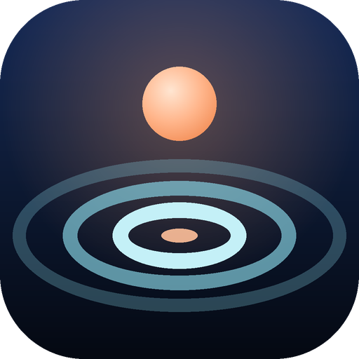
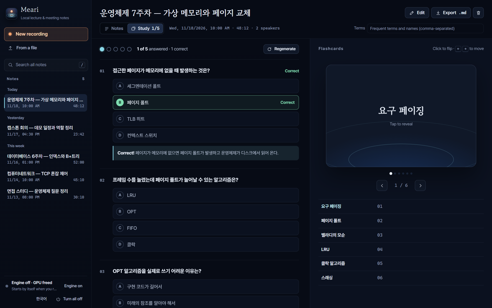
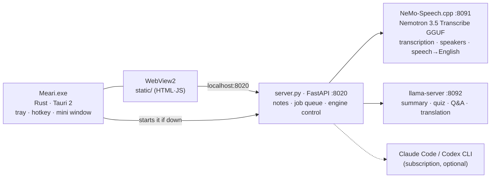

<div align="center">



# Meari (메아리)

**A local lecture & meeting recorder for ARM laptops with RTX Spark**

**✅ 100% Windows ARM64 native — no WSL, no Linux VM, no x64 emulation**

Press `Ctrl+Alt+M` to record, watch it transcribe as you speak, and get a summary, translation and study quiz when you stop.<br>
Everything runs on the laptop's own GPU with **NVIDIA Nemotron 3.5 Transcribe (NVFP4)** — your audio never leaves the machine.

`ARM64 native` · `Windows on ARM` · `RTX Spark (N1X)` · `128 GB unified memory` · `NeMo-Speech.cpp` · `llama.cpp` · `Rust/Tauri`

[한국어](README.md) | **English**

</div>


> The notes in these screenshots are fictional demo data.

## Screens

| Note — summary + speaker transcript | Study — quiz + flashcards |
|---|---|
|  |  |
| **Recording** | **Ask the note** |
|  |  |

<table>
<tr>
<td width="50%" valign="top">

**Mini window · phone**

Turn on **Mini window · always on top** from the tray menu and a phone-sized window stays in the corner of the screen,
so you can keep the live transcript next to your slides or meeting.
The same UI also opens on your phone (optional, over Tailscale).

</td>
<td width="25%"></td>
<td width="25%"></td>
</tr>
</table>

## ARM64 native

Meari runs **natively on Windows on ARM from end to end**. The app, the server, both AI engines and the helper tools are all ARM64 builds.
No WSL or Linux VM is started, and nothing runs under x64 emulation (Prism), so GPU memory goes to **the models and nothing else**.

| Part | Built with | Architecture |
|---|---|---|
| Desktop app `Meari.exe` (window · tray · hotkey) | Rust · Tauri 2 | **ARM64** (`aarch64-pc-windows-msvc`) |
| UI | WebView2 (Windows' built-in Edge engine) | **ARM64** |
| App server (notes · job queue · engine control) | Python 3.13 · FastAPI · numpy | **ARM64** |
| Speech engine | NeMo-Speech.cpp 0.3.0 `windows-aarch64-cuda` | **ARM64 + CUDA** |
| Local summary engine | llama.cpp `llama-server` | **ARM64 + CUDA** |
| Audio/video file conversion | ffmpeg | **ARM64** |
| Subscription engines (optional) | Claude Code CLI · Codex CLI | **ARM64** |

> Checked on this laptop from each executable's PE header (Machine = `0xAA64`).

## Features

| | |
|---|---|
| **Record** | Microphone / tab audio (online lectures and calls) / both. Live transcription in 8–16 s chunks, optional live English translation |
| **Instant start** | Recording starts immediately even while the engine is off; once the engine is up it catches up on the backlog |
| **Organize** | The speaker transcript is made automatically when you stop; the summary note is made when you press **Make summary note** (editable). English translation, ask questions about a note |
| **Lecture materials** | Upload PDF / PPTX / TXT and the matching page (p.N) appears next to each transcript line |
| **Study** | Multiple-choice quiz (graded, with explanations) + flashcards |
| **Search · export** | Full-text search across all notes, Markdown (.md) export |
| **From a file** | Create a note from an audio or video file |
| **Safety nets** | Warns right away if you record with a muted mic; the engine turns itself off after 30 idle minutes and frees GPU memory |
| **Desktop app** | Tray app, global hotkey, mini always-on-top window, low-memory mode while hidden |
| **Choose the summary engine** | Picked in the sidebar: a local model (Qwen3.8-27B · Qwen3.8-Flash-Next · Nemotron 120B from Hermes, …), Claude Sonnet / Opus (Claude Code subscription) or GPT (Codex subscription — Codex's default model, e.g. GPT-6.1 Sol). Used for summaries, quizzes and answers |
| **Korean / English UI** | One click in the sidebar (defaults to your system language). In English, summaries, quizzes and answers are written in English too |

## Specs

### Requirements

| Item | Tested setup |
|---|---|
| Device | RTX Spark (N1X) laptop — 128 GB unified memory (≈30 GB for Windows, ≈96 GB for the GPU) |
| GPU | Blackwell generation required (NVFP4 model) |
| OS | Windows 11 ARM64 — runs natively, **no WSL** |
| Speech engine | NVIDIA [NeMo-Speech.cpp](https://github.com/NVIDIA/NeMo-Speech.cpp) 0.3.0 `windows-aarch64-cuda` |
| Summary engine | llama.cpp `llama-server` (Windows ARM64 CUDA) with a local GGUF model, or the Claude Code / Codex CLI (subscription) |
| Disk | ≈21 GB speech model + a summary model (e.g. Qwen3.8-27B, 16.5 GB) |
| App build | Rust (`aarch64-pc-windows-msvc`), Visual Studio Build Tools (ARM64), WebView2 |

### Measured (on this laptop)

| Item | Value |
|---|---|
| Desktop app size · start | **6.7 MB** (Rust · Tauri 2) · app server in **≈2 s** |
| App memory | ≈440 MB with the window open · **60–110 MB** when hidden to the tray |
| Speech engine | **≈24 GB** of GPU memory, starts in **≈20 s**. Recording works right away and catches up |
| Transcription speed | 1 min 50 s of audio in 3.9 s · a 5-minute meeting with speakers in 25 s |
| Stop → speaker transcript | ≈6 s for a 1-minute recording |
| Summary note (button) | ≈38 s for a 1-minute recording (Qwen3.8-27B + DFlash2) |
| Subscription engines | Quiz: Claude Sonnet ≈12 s · GPT (Codex) ≈18 s; answers ≈10 s |
| Local summary engines (alongside the speech engine) | Qwen3.8-27B ≈22 GB, DFlash2 speculative decoding · Qwen3.8-Flash-Next ≈95 GB total, **MTP speculative decoding** (50–62% accepted) 32–38 tok/s · Nemotron Super 120B ≈95 GB total, 15 tok/s |
| Live transcription chunk | 8–16 s (cut where speech pauses) |
| Recording format | 16 kHz mono (browser AudioWorklet) |

## Architecture



When you stop recording, the speech engine finishes the speaker transcript and the note is done. The summary note is written when you press **Make summary note** (or **Redo summary**) in the note, by the summary engine chosen at that moment.

Both engines start when needed and stop after 30 idle minutes. Within the GPU budget (`MEARI_GPU_BUDGET_GB`) both stay loaded; above it they take turns. **Recording always wins**: if you start recording while a summary is being written, the audio is saved first and transcribed once the summary is done.

## Install (Windows native)

### 1. Speech engine and model

- Download `nemo-speech-0.3.0-windows-aarch64-cuda.zip` from the [NeMo-Speech.cpp releases](https://github.com/NVIDIA/NeMo-Speech.cpp/releases) and unzip it.
- Model (GGUF): NVIDIA's [`nvidia/NVIDIA-Nemotron-3.5-Transcribe-30B-A4B-GGUF`](https://huggingface.co/nvidia/NVIDIA-Nemotron-3.5-Transcribe-30B-A4B-GGUF) (sign-in required) or
  the `AD-NVFP4` decoder + `Encoder-F16` from the [AtomicChat conversion](https://huggingface.co/AtomicChat/NVIDIA-Nemotron-3.5-Transcribe-30B-A4B-GGUF) (same folder).

```powershell
hf download AtomicChat/NVIDIA-Nemotron-3.5-Transcribe-30B-A4B-GGUF `
  NVIDIA-Nemotron-3.5-Transcribe-30B-A4B-AD-NVFP4.gguf NVIDIA-Nemotron-3.5-Transcribe-30B-A4B-Encoder-F16.gguf `
  --local-dir D:\AI-Models\Speech\nemo-speech\models
```

### 2. Summary engine

- **Local**: a Windows ARM64 `llama-server.exe` (llama.cpp CUDA build) and a GGUF language model. If you use Hermes Agent, Meari reads
  the models and launch settings Hermes already has (`presets.ini`); you pick one in the app.
  Speculative decoding follows the Hermes settings too (a DFlash2 draft model for Qwen3.8-27B, MTP for Flash-Next).
- **Subscription (optional)**: sign in to the [Claude Code](https://claude.com/claude-code) CLI or the Codex CLI with your subscription and Claude or GPT become choices (no API keys).
  With these, **transcripts leave the PC** (audio files do not); the app says so when you pick one.
  - Claude: called as `claude -p` with no tools, MCP or saved session; choose Sonnet or Opus.
  - GPT: called as `codex exec` (read-only, ephemeral) with the `model` from `~/.codex/config.toml` (e.g. `gpt-6.1-sol`); the app shows that name.

### 3. Get Meari, the Python environment and the desktop app

```powershell
git clone https://github.com/ajh1004ajh00/meari.git
cd meari
python -m venv .venv-win                      # Python 3.13 ARM64
.venv-win\Scripts\pip install -r requirements-win.txt
copy local.env.example local.env               # engine and model paths (see Configuration)
cd desktop; cargo build --release; copy target\release\meari.exe ..\Meari.exe
```

### 4. Run

```powershell
.\Meari.exe          # open (starts the app server without a window; engines start when needed)
.\Meari.exe --rec    # open and start recording
```

- Make a desktop shortcut with target `Meari.exe --rec` and shortcut key `Ctrl+Alt+M` to start recording from anywhere.
- Turning off: **Turn all off** in the tray menu or the app (engines, server and window). **Engine off** frees only the GPU.
- To use it in a browser instead of the desktop app, run `launch.vbs` (`launch.vbs /rec` to record right away).

## Configuration (environment variables)

Put machine-specific values in `local.env` — copy `local.env.example`. The server reads it, and git ignores it.

| Variable | Default | Description |
|---|---|---|
| `MEARI_ASR_EXE` / `MEARI_ASR_MODEL` | `D:\AI-Models\Speech\nemo-speech\…` | NeMo-Speech executable / decoder GGUF |
| `MEARI_LLAMA_SERVER` | `D:\Tools\local-vlm\llamacpp\llama-server.exe` | llama-server for summaries |
| `MEARI_LLM` | `Qwen3.8-27B-UD-Q4_K_M` | Initial summary model (a name in Hermes' `presets.ini`); changeable in the app |
| `MEARI_LLM_MODEL` | (none) | GGUF path when not using Hermes |
| `MEARI_GPU_BUDGET_GB` | `80` | GPU budget for keeping both engines loaded; above it they take turns |
| `MEARI_FFMPEG` | `ffmpeg` | ffmpeg for uploaded audio/video files |
| `MEARI_SPEECH_LANG` | `ko` | Language spoken in recordings: `ko` / `en` / `auto` (separate from the UI language) |
| `MEARI_IDLE_OFF_MIN` | `30` | Minutes before idle engines turn off, `0` = never |
| `MEARI_FINAL_PIECE_S` / `MEARI_PIECE_OVERLAP_S` | `1800` / `60` | Speaker-pass part length / how much of the previous part each part re-reads (s) |
| `SORINOTE_DATA` | `./data` | Where notes are stored |
| `SORINOTE_HOSTS` | `127.0.0.1,localhost` | Allowed host names (add your Tailscale name for phone access) |

## Known limitations

- Windows-native transcription was verified with AtomicChat's GGUF conversion (`AD-NVFP4`). Used in llama.cpp for text generation, the same decoder repeats and drifts in Korean, so summaries use a separate language model.
- Speech recognition assumes Korean by default. For English recordings set `MEARI_SPEECH_LANG=en` (or `auto`).
- Long recordings are split into 30-minute parts for speaker labels. Each part re-reads the last minute of the one before, and people heard saying the same words there keep their number. Someone silent during that minute can get a new number in the next part.
- Translation is English only.
- Material-to-transcript linking is based on text overlap (no match for scanned PDFs or English slides with a Korean lecture).
- The old name `SoriNote` still appears in places (`SORINOTE_*`, `X-SoriNote`).

## License

- Code: [MIT](LICENSE)
- Model: Nemotron 3.5 Transcribe is under [OpenMDW 1.1](https://openmdw.ai/license/1-1/) and is not included in this repository.
