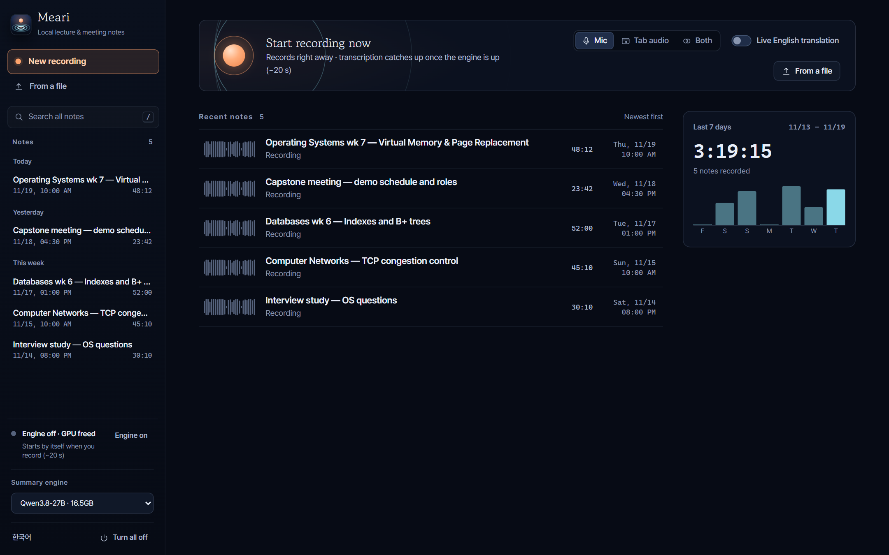
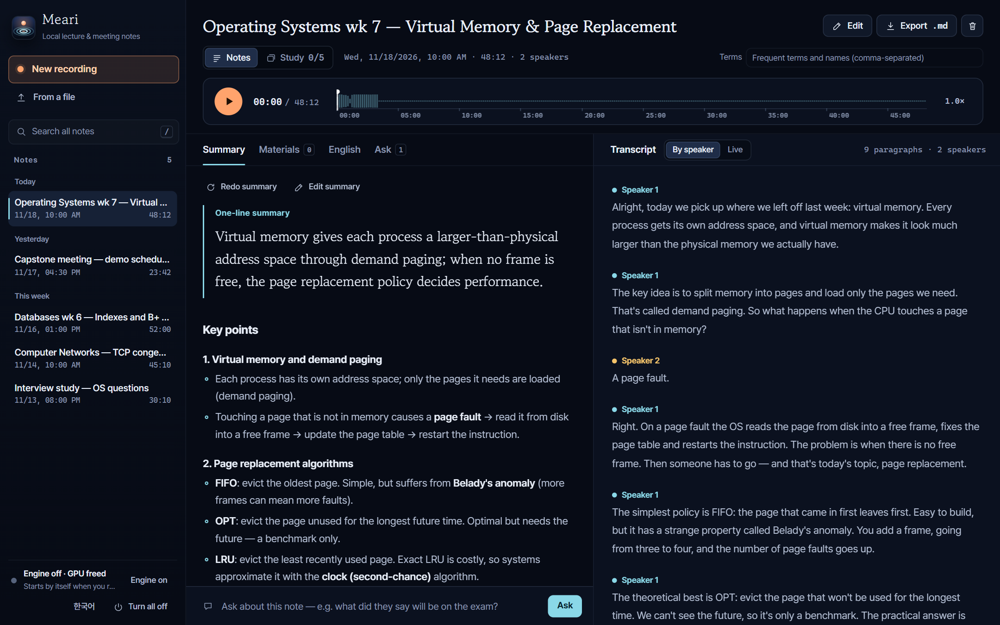
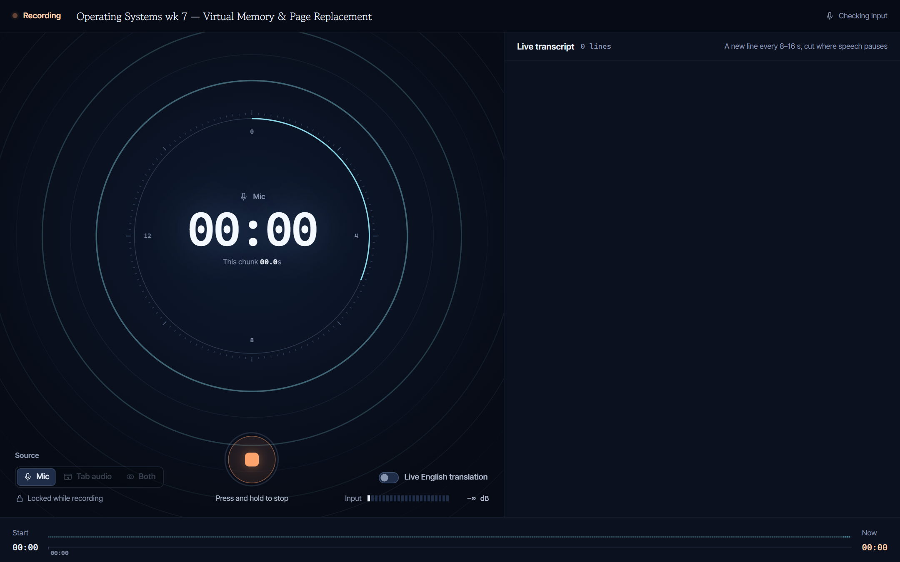
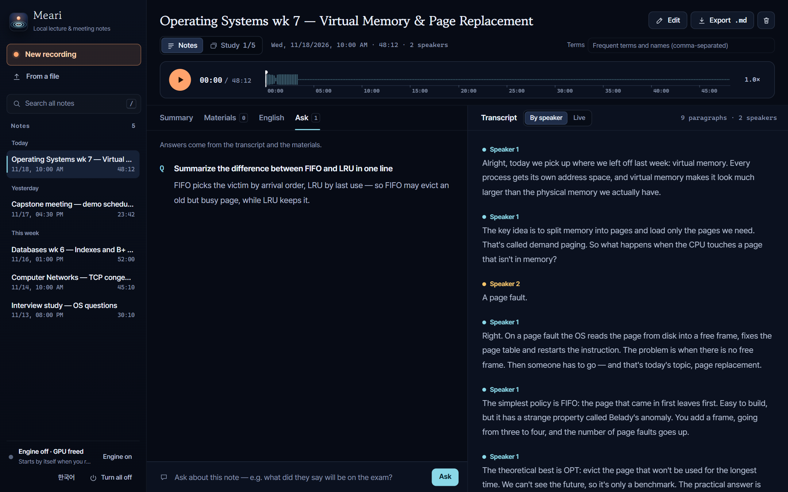
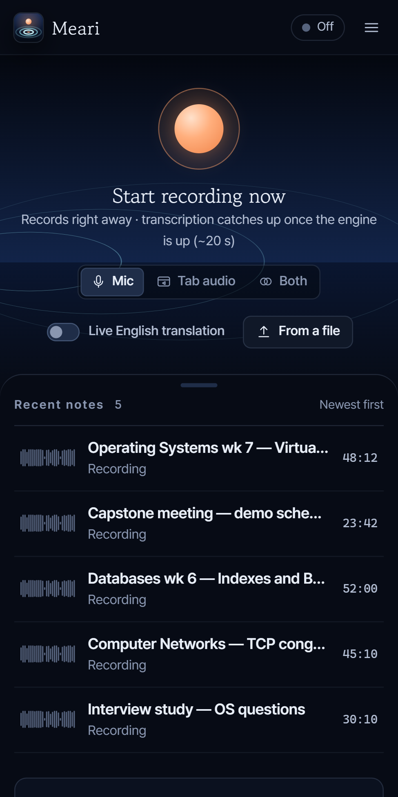
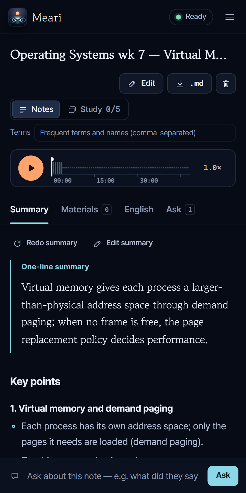
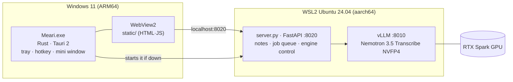

<div align="center">


# Meari (메아리)

**A local lecture & meeting recorder for ARM laptops with RTX Spark**

Press `Ctrl+Alt+M` to record, watch it transcribe as you speak, and get a summary, translation and study quiz when you stop.<br>
Everything runs on the laptop's own GPU with **NVIDIA Nemotron 3.5 Transcribe (NVFP4)** — your audio never leaves the machine.

`Windows on ARM` · `RTX Spark (N1X)` · `128 GB unified memory` · `WSL2` · `vLLM` · `Rust/Tauri`

[한국어](README.md) | **English**

</div>



> The notes in these screenshots are fictional demo data.

## Screens

| Note — summary + speaker transcript | Study — quiz + flashcards |
|---|---|
|  |  |
| **Recording** | **Ask the note** |
|  |  |

<table>
<tr>
<td width="50%" valign="top">

**Mini window · phone**

Turn on **Mini window · always on top** from the tray menu and a phone-sized window stays in the corner of the screen,
so you can keep the live transcript next to your slides or meeting.
The same UI also opens on your phone (optional, over Tailscale).

</td>
<td width="25%"></td>
<td width="25%"></td>
</tr>
</table>

## Features

| | |
|---|---|
| **Record** | Microphone / tab audio (online lectures and calls) / both. Live transcription in 8–16 s chunks, optional live English translation |
| **Instant start** | Recording starts immediately even while the engine is off; once the engine is up it catches up on the backlog |
| **Organize** | Speaker-separated transcript, editable summary note, English translation, ask questions about a note |
| **Lecture materials** | Upload PDF / PPTX / TXT and the matching page (p.N) appears next to each transcript line |
| **Study** | Multiple-choice quiz (graded, with explanations) + flashcards |
| **Search · export** | Full-text search across all notes, Markdown (.md) export |
| **From a file** | Create a note from an audio or video file |
| **Safety nets** | Warns right away if you record with a muted mic; the engine turns itself off after 30 idle minutes and frees GPU memory |
| **Desktop app** | Tray app, global hotkey, mini always-on-top window, low-memory mode while hidden |
| **Korean / English UI** | One click in the sidebar (defaults to your system language). In English, summaries, quizzes and answers are written in English too |

## Specs

### Requirements

| Item | Tested setup |
|---|---|
| Device | RTX Spark (N1X) laptop — 128 GB unified memory (≈30 GB for Windows, ≈96 GB for the GPU) |
| GPU | Blackwell generation required (NVFP4 model) |
| OS | Windows 11 ARM64 + WSL2 `Ubuntu-24.04` (aarch64) |
| Engine | vLLM 0.32.0 + NeMo Speech (main) plugin, CUDA 13.0, Python 3.13 |
| Disk | ≈21 GB for the model, plus the environment |
| App build | Rust (`aarch64-pc-windows-msvc`), Visual Studio Build Tools (ARM64), WebView2 |

### Measured (on this laptop)

| Item | Value |
|---|---|
| Desktop app size | **6.7 MB** (Rust · Tauri 2) |
| App memory | ≈440 MB with the window open · **60–110 MB** when hidden to the tray |
| Engine GPU memory | ≈42 GB (`GPU_UTIL=0.38`) |
| Engine start-up | ≈**2 min 30 s** (longer on the very first run while kernels compile). Recording works right away |
| Peak WSL memory while the engine loads | **9.2 GB** (15.2 GB before the fix) · Windows free memory stays ≥ 5.3 GB |
| Live transcription chunk | 8–16 s (cut where speech pauses) |
| Recording format | 16 kHz mono (browser AudioWorklet) |

## Architecture



## Install

### 1. WSL and the engine (NeMo Speech + vLLM)

Install the WSL distro from PowerShell:

```powershell
wsl --install -d Ubuntu-24.04
```

Inside WSL (as `root`), follow the official steps from the [model card](https://huggingface.co/nvidia/NVIDIA-Nemotron-3.5-Transcribe-30B-A4B-NVFP4).
Meari uses `/root/nemo-speech` and `/root/models` by default.

```bash
cd /root
git clone https://github.com/NVIDIA-NeMo/Speech.git nemo-speech
cd nemo-speech
uv venv --python 3.13 .venv
UV_PROJECT_ENVIRONMENT=$PWD/.venv uv sync --extra asr --extra vllm --locked --no-install-project
uv pip install --python .venv/bin/python --no-deps -e .
uv pip install --python .venv/bin/python --no-deps av==19.0.2 opencv-python-headless==5.0.0.93
```

### 2. Download the model (≈21 GB)

```bash
source /root/nemo-speech/.venv/bin/activate
hf download nvidia/NVIDIA-Nemotron-3.5-Transcribe-30B-A4B-NVFP4 \
  --local-dir /root/models/NVIDIA-Nemotron-3.5-Transcribe-30B-A4B-NVFP4
```

### 3. WSL patches

On a unified-memory GPU under WSL, vLLM refuses to start (it sizes GPU memory from WSL's 15 GB of Linux RAM), and the
FlashInfer JIT needs CUDA 13.0 paths. The fixes are in **[docs/SETUP-WSL.md](docs/SETUP-WSL.md)** (Korean; the commands are self-explanatory).

### 4. App server packages

```bash
uv pip install --python /root/nemo-speech/.venv/bin/python \
  fastapi uvicorn python-multipart requests numpy soundfile pypdf python-pptx
```

### 5. Get Meari and build the desktop app

Clone on Windows (somewhere WSL can reach under `/mnt/...`) and build:

```powershell
git clone https://github.com/ajh1004ajh00/meari.git
cd meari\desktop
cargo build --release
copy target\release\meari.exe ..\Meari.exe
```

### 6. Run

```powershell
.\Meari.exe          # open (starts the server in WSL if it is down)
.\Meari.exe --rec    # open and start recording
```

- Make a desktop shortcut with target `Meari.exe --rec` and shortcut key `Ctrl+Alt+M` to start recording from anywhere.
- The first engine start takes a few extra minutes for kernel compilation. You can record while it starts.
- Turning off: **Turn everything off** in the tray menu or the app (engine, server and window). **Engine off** frees only the GPU.
- To use it in a browser instead of the desktop app, run `launch.vbs` (`launch.vbs /rec` to record right away).

## Configuration (environment variables)

Put machine-specific values (Tailscale name, where notes live, ...) in `local.env` — copy `local.env.example`. `scripts/run.sh` reads it, and git ignores it.

| Variable | Default | Description |
|---|---|---|
| `MEARI_NEMO_DIR` | `/root/nemo-speech` | NeMo Speech checkout (its `.venv` is used) |
| `MEARI_MODEL` | `/root/models/NVIDIA-Nemotron-3.5-Transcribe-30B-A4B-NVFP4` | Model folder |
| `GPU_UTIL` | `0.38` | vLLM `--gpu-memory-utilization` |
| `MAX_SEQS` | `8` | Concurrent requests |
| `ENGINE_MEM_HIGH` | `6G` | Memory ceiling while the engine starts (`max` = off) |
| `MEARI_SPEECH_LANG` | `ko` | Language spoken in recordings: `ko` / `en` / `auto` (separate from the UI language) |
| `MEARI_IDLE_OFF_MIN` | `30` | Minutes before the idle engine turns off, `0` = never |
| `SORINOTE_DATA` | `./data` | Where notes are stored |
| `SORINOTE_HOSTS` | `127.0.0.1,localhost` | Allowed host names (add your Tailscale name for phone access) |
| `MEARI_WSL_DISTRO` | `Ubuntu-24.04` | WSL distro the desktop app starts the server in |
| `MEARI_DIR` | found from the exe location | Repository folder used by the desktop app |

## Known limitations

- Speech recognition assumes Korean by default. For English recordings set `MEARI_SPEECH_LANG=en` (or `auto`).
- Speaker numbers restart every 30-minute part.
- Translation is English only.
- Material-to-transcript linking is based on text overlap (no match for scanned PDFs or English slides with a Korean lecture).
- The old name `SoriNote` still appears in places (`SORINOTE_*`, `X-SoriNote`).

## License

- Code: [MIT](LICENSE)
- Model: Nemotron 3.5 Transcribe is under [OpenMDW 1.1](https://openmdw.ai/license/1-1/) and is not included in this repository.
