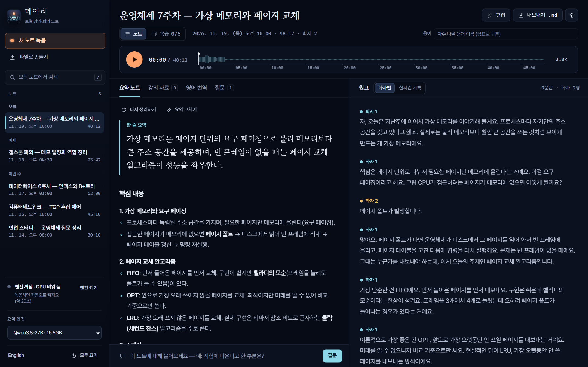
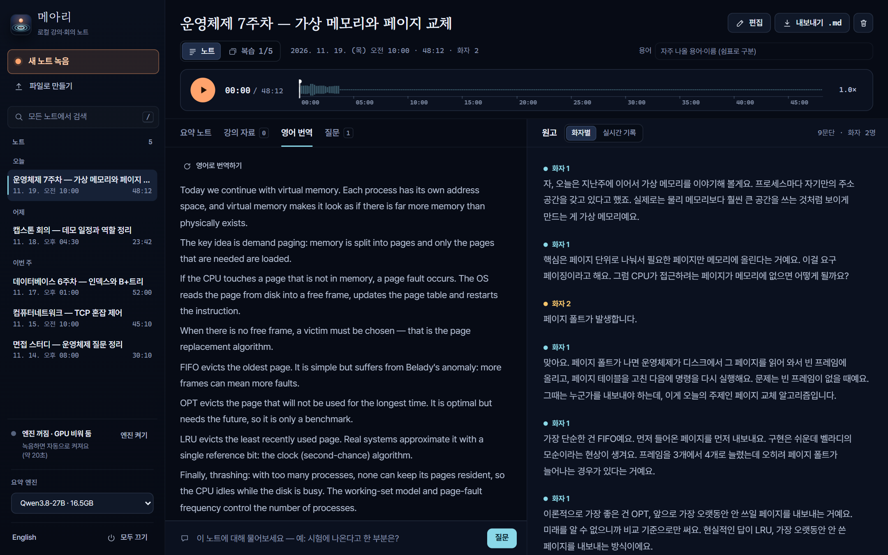
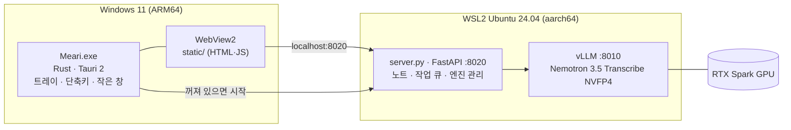

<div align="center">


# 메아리 (Meari)

**ARM 노트북 · RTX Spark를 위한 로컬 녹음 노트 앱**

`Ctrl+Alt+M` 한 번으로 녹음하고, 말하는 동안 받아쓰고, 끝나면 요약·번역·복습 퀴즈까지.<br>
모든 처리는 노트북 GPU 안에서 **NVIDIA Nemotron 3.5 Transcribe (NVFP4)** 로 — 음성은 밖으로 나가지 않아요.

`Windows on ARM` · `RTX Spark (N1X)` · `통합 메모리 128GB` · `WSL2` · `vLLM` · `Rust/Tauri`

**한국어** | [English](README.en.md)

</div>


> 화면의 노트는 README용 예시 데이터예요.

## 화면

| 노트 — 요약 + 화자별 원고 | 복습 — 퀴즈 + 암기카드 |
|---|---|
|  |  |
| **녹음** | **영어 번역** |
|  |  |

<table>
<tr>
<td width="50%" valign="top">

**작은 창 · 휴대폰**

트레이 메뉴의 **작은 창 · 항상 위**를 켜면 휴대폰 크기 창이 화면 구석에 떠 있어요.
강의 자료나 회의 화면을 보면서 받아쓰기를 옆에 띄워 둘 수 있어요.
같은 화면으로 휴대폰에서도 열 수 있어요(Tailscale, 선택).

</td>
<td width="25%"></td>
<td width="25%"></td>
</tr>
</table>

## 기능

| | |
|---|---|
| **녹음** | 마이크 / 탭 소리(온라인 강의·회의) / 둘 다. 8~16초 단위 실시간 받아쓰기, 실시간 영어 번역(선택) |
| **바로 시작** | 엔진이 꺼져 있어도 녹음은 즉시 시작, 엔진이 켜지면 밀린 부분을 따라잡음 |
| **정리** | 화자별 원고, 요약 노트(직접 수정 가능), 영어 번역, 노트에 질문하기 |
| **강의 자료** | PDF·PPTX·TXT를 올리면 원고 문장 옆에 관련 페이지(p.N) 표시 |
| **복습** | 객관식 퀴즈(채점·해설) + 암기카드 |
| **검색 · 내보내기** | 모든 노트 전체 검색, 마크다운(.md) 내보내기 |
| **파일로 만들기** | 음성·영상 파일을 올려서 노트 만들기 |
| **안전장치** | 음소거된 마이크로 녹음하면 바로 경고, 30분 동안 안 쓰면 엔진이 스스로 꺼져 GPU 메모리 반환 |
| **데스크톱 앱** | 트레이 상주, 전역 단축키, 작은 창(항상 위), 숨기면 저메모리 모드 |
| **한국어 / English** | 사이드바 버튼 하나로 화면 언어 전환, 기본값은 시스템 언어 |

## 사양

### 필요한 환경

| 항목 | 확인한 환경 |
|---|---|
| 기기 | RTX Spark(N1X) 노트북 — 통합 메모리 128GB (Windows 약 30GB, GPU 약 96GB) |
| GPU | Blackwell 세대 필요 (NVFP4 모델) |
| OS | Windows 11 ARM64 + WSL2 `Ubuntu-24.04` (aarch64) |
| 엔진 | vLLM 0.32.0 + NeMo Speech(main) 플러그인, CUDA 13.0, Python 3.13 |
| 디스크 | 모델 약 21GB + 환경 |
| 앱 빌드 | Rust (`aarch64-pc-windows-msvc`), Visual Studio Build Tools (ARM64), WebView2 |

### 측정값 (이 노트북 기준)

| 항목 | 값 |
|---|---|
| 데스크톱 앱 크기 | **6.7MB** (Rust · Tauri 2) |
| 앱 메모리 | 창이 보일 때 약 440MB · 트레이로 숨기면 **60~110MB** |
| 엔진 GPU 메모리 | 약 42GB (`GPU_UTIL=0.38`) |
| 엔진 준비 시간 | 약 **2분 30초** (첫 실행은 커널 컴파일로 더 오래 걸림). 녹음은 바로 가능 |
| 엔진 켜질 때 WSL 최대 메모리 | **9.2GB** (대책 전 15.2GB) · Windows 여유 메모리 최저 5.3GB |
| 실시간 받아쓰기 단위 | 8~16초 (말이 멈춘 지점에서 자름) |
| 녹음 형식 | 16kHz mono (브라우저 AudioWorklet) |

## 구조



## 설치

### 1. WSL과 엔진 (NeMo Speech + vLLM)

PowerShell에서 WSL 배포판을 설치하고:

```powershell
wsl --install -d Ubuntu-24.04
```

WSL 안(`root`)에서 [모델 카드](https://huggingface.co/nvidia/NVIDIA-Nemotron-3.5-Transcribe-30B-A4B-NVFP4)의 공식 방법대로 설치해요.
메아리는 기본으로 `/root/nemo-speech`와 `/root/models`를 써요.

```bash
cd /root
git clone https://github.com/NVIDIA-NeMo/Speech.git nemo-speech
cd nemo-speech
uv venv --python 3.13 .venv
UV_PROJECT_ENVIRONMENT=$PWD/.venv uv sync --extra asr --extra vllm --locked --no-install-project
uv pip install --python .venv/bin/python --no-deps -e .
uv pip install --python .venv/bin/python --no-deps av==19.0.2 opencv-python-headless==5.0.0.93
```

### 2. 모델 받기 (약 21GB)

```bash
source /root/nemo-speech/.venv/bin/activate
hf download nvidia/NVIDIA-Nemotron-3.5-Transcribe-30B-A4B-NVFP4 \
  --local-dir /root/models/NVIDIA-Nemotron-3.5-Transcribe-30B-A4B-NVFP4
```

### 3. WSL 대응 패치

통합 메모리 GPU를 WSL에서 쓸 때 vLLM이 시작을 거부하는 문제와 CUDA 13.0 경로 문제를 고쳐요.
명령은 **[docs/SETUP-WSL.md](docs/SETUP-WSL.md)** 에 있어요.

### 4. 앱 서버 패키지

```bash
uv pip install --python /root/nemo-speech/.venv/bin/python \
  fastapi uvicorn python-multipart requests numpy soundfile pypdf python-pptx
```

### 5. 메아리 받기 · 데스크톱 앱 빌드

Windows에서 저장소를 받고(WSL에서 `/mnt/...`로 접근할 수 있는 위치), 데스크톱 앱을 빌드해요.

```powershell
git clone https://github.com/ajh1004ajh00/meari.git
cd meari\desktop
cargo build --release
copy target\release\meari.exe ..\Meari.exe
```

### 6. 실행

```powershell
.\Meari.exe          # 열기 (서버가 꺼져 있으면 WSL에서 자동으로 켬)
.\Meari.exe --rec    # 열고 바로 녹음
```

- 바탕화면 바로가기를 만들고 대상에 `Meari.exe --rec`, 바로 가기 키에 `Ctrl+Alt+M`을 넣으면 어디서든 바로 녹음돼요.
- 처음 엔진을 켤 때는 커널 컴파일 때문에 몇 분 더 걸려요. 엔진이 켜지는 동안에도 녹음은 바로 돼요.
- 끄기: 트레이 메뉴나 앱의 **모두 끄기**(엔진·서버·창). GPU만 비우려면 **엔진 끄기**.
- 데스크톱 앱 없이 브라우저로 쓰려면 `launch.vbs`(바로 녹음은 `launch.vbs /rec`).

## 설정 (환경 변수)

| 변수 | 기본값 | 설명 |
|---|---|---|
| `MEARI_NEMO_DIR` | `/root/nemo-speech` | NeMo Speech 체크아웃(그 안의 `.venv` 사용) |
| `MEARI_MODEL` | `/root/models/NVIDIA-Nemotron-3.5-Transcribe-30B-A4B-NVFP4` | 모델 폴더 |
| `GPU_UTIL` | `0.38` | vLLM `--gpu-memory-utilization` |
| `MAX_SEQS` | `8` | 동시 처리 요청 수 |
| `ENGINE_MEM_HIGH` | `6G` | 엔진이 켜지는 동안의 메모리 상한 (`max` = 끔) |
| `MEARI_IDLE_OFF_MIN` | `30` | 엔진 자동 끄기까지의 시간(분), `0` = 끔 |
| `SORINOTE_DATA` | `./data` | 노트 저장 위치 |
| `SORINOTE_HOSTS` | `127.0.0.1,localhost` | 허용할 호스트(휴대폰용 Tailscale 이름 추가) |
| `MEARI_WSL_DISTRO` | `Ubuntu-24.04` | 데스크톱 앱이 서버를 켤 WSL 배포판 |
| `MEARI_DIR` | 실행 파일 위치에서 찾음 | 데스크톱 앱이 쓸 저장소 폴더 |

## 알려진 한계

- 화자 번호는 30분 구간마다 새로 매겨져요.
- 번역은 영어만 지원해요.
- 자료-원고 연결은 글자 겹침 기반이에요(스캔본 PDF, 영어 자료 + 한국어 강의에서는 연결 안 됨).
- 코드 곳곳에 옛 이름 `SoriNote`가 남아 있어요(`SORINOTE_*`, `X-SoriNote`).

## 라이선스

- 코드: [MIT](LICENSE)
- 모델: Nemotron 3.5 Transcribe는 [OpenMDW 1.1](https://openmdw.ai/license/1-1/)을 따르며 이 저장소에 포함되어 있지 않아요.
