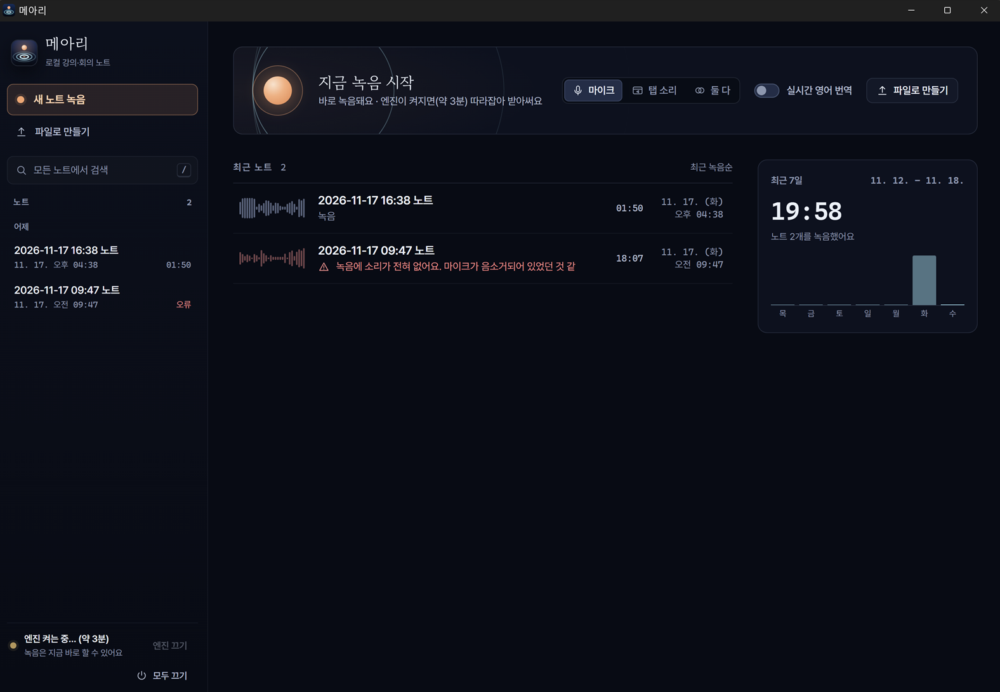
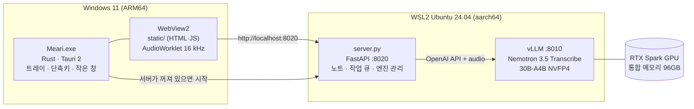

# 메아리 (Meari)

**ARM 노트북 · RTX Spark를 위한 로컬 강의·회의 녹음 노트**

`Ctrl+Alt+M` 한 번이면 녹음이 시작되고, 말하는 동안 실시간으로 받아써요. 녹음이 끝나면 화자별 원고, 요약 노트, 영어 번역,
복습 퀴즈까지 만들어요. 모든 처리는 노트북 안의 GPU에서 **NVIDIA Nemotron 3.5 Transcribe (NVFP4)** 로 하고, 음성은 밖으로 나가지 않아요.



> Windows on ARM(NVIDIA N1X) + 통합 메모리 GPU 노트북에서 30B 음성 모델을 WSL로 띄워
> 매일 쓰는 앱으로 만든 기록이기도 해요. 같은 하드웨어가 아니면 그대로는 동작하지 않아요(→ [요구 사양](#요구-사양)).

## 기능

**녹음 · 받아쓰기**
- 마이크 / 탭 소리(온라인 강의·회의) / 둘 다 녹음, 8~16초 단위 실시간 받아쓰기(말이 멈춘 지점에서 자름)
- 실시간 영어 번역(선택)
- 엔진이 꺼져 있어도 **녹음은 바로 시작**돼요. 엔진이 켜지면 밀린 조각을 순서대로 따라잡아요.
- 무음 감지: 마이크가 음소거된 채 녹음하면 바로 알려주고, 소리 없는 녹음은 정리하지 않아요.
- 음성 파일·영상 파일을 올려서 노트 만들기

**정리 · 복습**
- 화자별 원고, 요약 노트(직접 고치기 가능), 영어 번역, 노트에 질문하기
- 강의 자료(PDF·PPTX·TXT)를 올리면 원고 문장 옆에 관련 페이지(p.N)를 표시
- 복습: 객관식 퀴즈(채점·해설) + 암기 카드
- 모든 노트 전체 검색, 마크다운으로 내보내기

**데스크톱 앱 (Rust · Tauri)**
- 6.7MB 단일 실행 파일, 시스템 트레이 상주, 실행 중에 다시 열면 같은 창을 앞으로 가져옴
- **작은 창 · 항상 위**: 휴대폰 크기 창을 화면 구석에 띄워 두고 다른 작업과 함께 녹음
- 창을 숨기면 애니메이션을 멈추고 WebView2를 저메모리 모드로 전환(약 440MB → 60~110MB)
- 휴대폰: Tailscale로 같은 계정 기기에서만 접속(선택)

## 구조



| 경로 | 내용 |
|---|---|
| `desktop/` | 데스크톱 앱 (Tauri 2, Rust). 서버를 켜고 화면을 띄우는 껍데기 |
| `static/` | 화면 (바닐라 JS, 빌드 도구 없음) |
| `server.py` | 백엔드. 녹음 조각 저장, 받아쓰기·요약·번역 작업 큐, 엔진 켜고 끄기, 메모리 관리 |
| `scripts/engine.sh` | vLLM으로 Nemotron 엔진 실행 (켜지는 동안 cgroup 메모리 상한) |
| `scripts/run.sh` | 엔진(없으면)과 앱 서버 실행 |
| `launch.vbs`, `stop.vbs`, `starting.html` | 데스크톱 앱 없이 브라우저로 쓰는 실행기 |
| `docs/SETUP-WSL.md` | 엔진 설치와 WSL 대응 패치 |
| `docs/design/` | 디자인 시안 (HTML) |

## 요구 사양

| 항목 | 확인한 환경 |
|---|---|
| 하드웨어 | RTX Spark(N1X) 노트북, 통합 메모리 128GB (GPU 약 96GB) |
| GPU 메모리 | 엔진이 약 42GB 사용 (`GPU_UTIL=0.38`) |
| OS | Windows 11 ARM64 + WSL2 `Ubuntu-24.04` |
| 엔진 | vLLM 0.32.0 + NeMo Speech 플러그인, CUDA 13.0 |
| 데스크톱 앱 빌드 | Rust (aarch64-pc-windows-msvc), Visual Studio Build Tools (ARM64), WebView2 |

엔진 설치 방법과 vLLM이 WSL에서 막히는 지점(통합 메모리 판정, CUDA 경로)은 **[docs/SETUP-WSL.md](docs/SETUP-WSL.md)** 에 정리했어요.

## 빠른 시작

```powershell
# 1) 엔진 설치: docs/SETUP-WSL.md

# 2) 데스크톱 앱 빌드 → 저장소 루트에 Meari.exe로 복사
cd desktop
cargo build --release
copy target\release\meari.exe ..\Meari.exe

# 3) 실행 (서버가 꺼져 있으면 WSL에서 자동으로 켬)
..\Meari.exe          # 열기
..\Meari.exe --rec    # 열고 바로 녹음
```

바탕화면 바로가기에 `Meari.exe --rec`과 단축키 `Ctrl+Alt+M`을 지정하면 어디서든 바로 녹음돼요.
브라우저로 쓰려면 `launch.vbs`(녹음까지 하려면 `launch.vbs /rec`)를 실행하세요.

**끄기**: 트레이 메뉴나 앱의 **모두 끄기**(엔진·서버·창). GPU만 비우려면 **엔진 끄기**.
30분 동안 쓰지 않으면 엔진이 스스로 꺼져요(녹음·정리 중에는 꺼지지 않음).

## 설정 (환경 변수)

| 변수 | 기본값 | 설명 |
|---|---|---|
| `MEARI_NEMO_DIR` | `/root/nemo-speech` | NeMo Speech 체크아웃(그 안의 `.venv` 사용) |
| `MEARI_MODEL` | `/root/models/NVIDIA-Nemotron-3.5-Transcribe-30B-A4B-NVFP4` | 모델 폴더 |
| `GPU_UTIL` | `0.38` | vLLM `--gpu-memory-utilization` |
| `MAX_SEQS` | `8` | 동시 처리 요청 수 |
| `ENGINE_MEM_HIGH` | `6G` | 엔진이 켜지는 동안의 cgroup `memory.high` (`max` = 끔) |
| `MEARI_IDLE_OFF_MIN` | `30` | 엔진 자동 끄기까지의 시간(분), `0` = 끔 |
| `ENGINE_URL` | `http://127.0.0.1:8010/v1` | 엔진 주소 |
| `SORINOTE_DATA` | `./data` | 노트 저장 위치 |
| `SORINOTE_HOSTS` | `127.0.0.1,localhost` | 허용할 호스트 이름(휴대폰용 Tailscale 이름 추가) |
| `MEARI_WSL_DISTRO` | `Ubuntu-24.04` | 데스크톱 앱이 서버를 켤 WSL 배포판 |
| `MEARI_DIR` | 실행 파일 위치에서 찾음 | 데스크톱 앱이 쓸 저장소 폴더 |

## 만들면서 푼 문제

- **WSL 15GB 한도와 30B 모델**: 엔진이 켜질 때 vLLM이 모델 파일 약 10GB를 한꺼번에 매핑해서, WSL이 한도를 다 채우고 Windows 여유 메모리가 1GB 아래로 떨어졌어요(WSL이 통째로 꺼짐).
  매핑된 페이지는 `drop_caches`로 비울 수 없다는 걸 확인하고, 켜지는 동안만 cgroup `memory.high`를 걸어 커널이 회수하게 했어요.
  측정 결과 WSL 최대 **15.2GB → 9.2GB**, Windows 여유 메모리 최저 **0.97GB → 5.3GB**. (`.wslconfig`는 건드리지 않음)
- **통합 메모리 GPU에서 vLLM이 시작을 거부**: WSL 안의 RAM(15GB)으로 GPU 여유 메모리를 계산하는 문제. 환경 변수로 끌 수 있게 패치했어요.
- **짧은 조각에서 다른 언어로 받아쓰기**: 한국어 힌트 프롬프트, 발화 비율 기반 VAD 게이트, 반복 출력 정리로 해결했어요.
- **음소거 마이크로 18분 녹음**: 무음 감시를 추가해서 녹음 중에 바로 알리고, 소리 없는 녹음은 정리를 거부해요.
- **"눌렀는데 반응이 없다"**: 엔진이 켜지는 동안 바로 보이는 시작 화면, 녹음 먼저 시작 후 따라잡는 백로그 큐.

## 알려진 한계

- 화자 번호는 30분 구간마다 새로 매겨져요.
- 번역은 영어만 지원해요.
- 자료-원고 연결은 글자 겹침 기반이에요. 스캔본 PDF(글자 없음)나 영어 자료 + 한국어 강의 조합에서는 연결되지 않아요.
- 첫 엔진 시작은 커널 컴파일 때문에 오래 걸리고, 그 뒤로는 약 2분 30초 걸려요(녹음은 바로 가능).
- 코드 곳곳에 옛 이름 `SoriNote`가 남아 있어요(환경 변수 `SORINOTE_*`, 헤더 `X-SoriNote`).

## 라이선스

코드: [MIT](LICENSE). 모델(Nemotron 3.5 Transcribe)은 NVIDIA 라이선스를 따르며 이 저장소에 포함되어 있지 않아요.

---

### English

**Meari** is a local lecture/meeting recorder for **Windows on ARM laptops with an NVIDIA RTX Spark (unified-memory) GPU**.
Press `Ctrl+Alt+M` to start recording with live transcription; afterwards it builds a speaker-separated transcript, summary,
English translation, Q&A and study quizzes — all on-device with NVIDIA Nemotron 3.5 Transcribe (NVFP4) served by vLLM in WSL2.
The desktop shell is a 6.7 MB Rust/Tauri tray app. See [docs/SETUP-WSL.md](docs/SETUP-WSL.md) for the vLLM-on-WSL patches and
the cgroup trick that cut peak WSL memory during model load from 15.2 GB to 9.2 GB.
