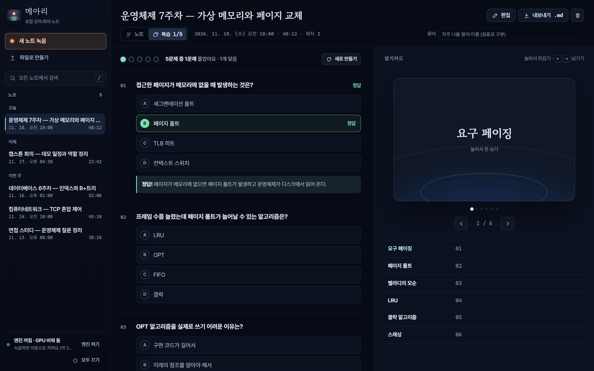
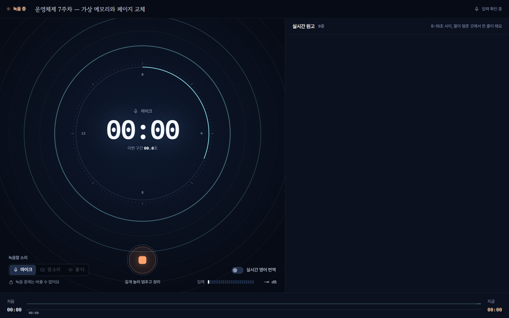
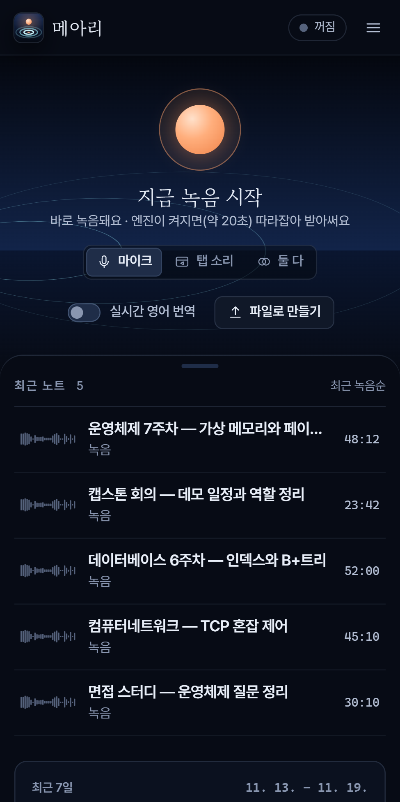
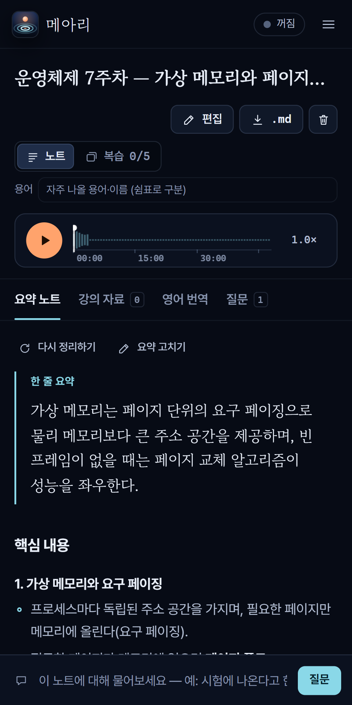
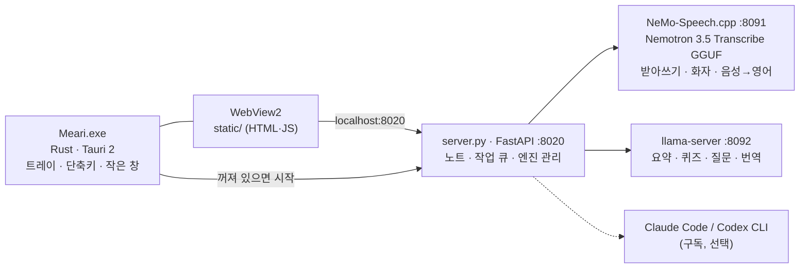

<div align="center">


# 메아리 (Meari)

**ARM 노트북 · RTX Spark를 위한 로컬 녹음 노트 앱**

`Ctrl+Alt+M` 한 번으로 녹음하고, 말하는 동안 받아쓰고, 끝나면 요약·번역·복습 퀴즈까지.<br>
모든 처리는 노트북 GPU 안에서 **NVIDIA Nemotron 3.5 Transcribe (NVFP4)** 로 — 음성은 밖으로 나가지 않아요.

`Windows on ARM` · `RTX Spark (N1X)` · `통합 메모리 128GB` · `NeMo-Speech.cpp` · `llama.cpp` · `Rust/Tauri`

**한국어** | [English](README.en.md)

</div>


> 화면의 노트는 README용 예시 데이터예요.

## 화면

| 노트 — 요약 + 화자별 원고 | 복습 — 퀴즈 + 암기카드 |
|---|---|
|  |  |
| **녹음** | **영어 번역** |
|  |  |

<table>
<tr>
<td width="50%" valign="top">

**작은 창 · 휴대폰**

트레이 메뉴의 **작은 창 · 항상 위**를 켜면 휴대폰 크기 창이 화면 구석에 떠 있어요.
강의 자료나 회의 화면을 보면서 받아쓰기를 옆에 띄워 둘 수 있어요.
같은 화면으로 휴대폰에서도 열 수 있어요(Tailscale, 선택).

</td>
<td width="25%"></td>
<td width="25%"></td>
</tr>
</table>

## 기능

| | |
|---|---|
| **녹음** | 마이크 / 탭 소리(온라인 강의·회의) / 둘 다. 8~16초 단위 실시간 받아쓰기, 실시간 영어 번역(선택) |
| **바로 시작** | 엔진이 꺼져 있어도 녹음은 즉시 시작, 엔진이 켜지면 밀린 부분을 따라잡음 |
| **정리** | 화자별 원고, 요약 노트(직접 수정 가능), 영어 번역, 노트에 질문하기 |
| **강의 자료** | PDF·PPTX·TXT를 올리면 원고 문장 옆에 관련 페이지(p.N) 표시 |
| **복습** | 객관식 퀴즈(채점·해설) + 암기카드 |
| **검색 · 내보내기** | 모든 노트 전체 검색, 마크다운(.md) 내보내기 |
| **파일로 만들기** | 음성·영상 파일을 올려서 노트 만들기 |
| **안전장치** | 음소거된 마이크로 녹음하면 바로 경고, 30분 동안 안 쓰면 엔진이 스스로 꺼져 GPU 메모리 반환 |
| **데스크톱 앱** | 트레이 상주, 전역 단축키, 작은 창(항상 위), 숨기면 저메모리 모드 |
| **요약 엔진 선택** | 로컬 모델(Hermes에 있는 Qwen 27B · Flash-Next · Nemotron 120B 등) 또는 Claude · GPT 구독(CLI) 중에서 사이드바에서 골라요 |
| **한국어 / English** | 사이드바 버튼 하나로 화면 언어 전환(기본값은 시스템 언어). 영어 화면에서는 요약·퀴즈·답변도 영어로 만들어요 |

## 사양

### 필요한 환경

| 항목 | 확인한 환경 |
|---|---|
| 기기 | RTX Spark(N1X) 노트북 — 통합 메모리 128GB (Windows 약 30GB, GPU 약 96GB) |
| GPU | Blackwell 세대 필요 (NVFP4 모델) |
| OS | Windows 11 ARM64 — **WSL 없이** 동작 (WSL + vLLM 방식도 지원) |
| 받아쓰기 엔진 | NVIDIA [NeMo-Speech.cpp](https://github.com/NVIDIA/NeMo-Speech.cpp) 0.3.0 `windows-aarch64-cuda` |
| 요약 엔진 | llama.cpp `llama-server` (Windows ARM64 CUDA) + 로컬 GGUF 모델, 또는 Claude Code / Codex CLI(구독) |
| 디스크 | 받아쓰기 모델 약 21GB + 요약 모델(예: Qwen3.8-27B 16.5GB) |
| 앱 빌드 | Rust (`aarch64-pc-windows-msvc`), Visual Studio Build Tools (ARM64), WebView2 |

### 측정값 (이 노트북 기준)

| 항목 | 값 |
|---|---|
| 데스크톱 앱 크기 · 시작 | **6.7MB** (Rust · Tauri 2) · 앱 서버 **약 2초** |
| 앱 메모리 | 창이 보일 때 약 440MB · 트레이로 숨기면 **60~110MB** |
| 받아쓰기 엔진 | GPU **약 24GB**, 켜지는 데 **약 20초**. 녹음은 바로 가능(켜지면 따라잡음) |
| 받아쓰기 속도 | 1분 50초 녹음 3.9초 · 5분 회의 + 화자 구분 25초 |
| 녹음 끝 → 화자별 원고 + 요약 | 1분 녹음 약 45초 (Qwen3.8-27B + DFlash2) |
| 요약 엔진 (한국어 요약 · 받아쓰기 엔진과 함께) | Qwen3.8-27B 약 22GB · Qwen3.8-Flash-Next +62GB, 초당 32토큰 · Nemotron Super 120B +62GB, 초당 15토큰 |
| 실시간 받아쓰기 단위 | 8~16초 (말이 멈춘 지점에서 자름) |
| 녹음 형식 | 16kHz mono (브라우저 AudioWorklet) |

## 구조



두 엔진은 필요할 때 켜지고, 30분 동안 안 쓰면 꺼져요. GPU 예산(`MEARI_GPU_BUDGET_GB`) 안이면 둘 다 켜 두고, 넘으면 번갈아 켜요. **녹음이 항상 우선**이라, 요약 중에 녹음을 시작하면 녹음 조각을 먼저 저장해 두고 요약이 끝나면 따라잡아 받아써요.

## 설치 (Windows 네이티브)

### 1. 받아쓰기 엔진과 모델

- [NeMo-Speech.cpp 릴리스](https://github.com/NVIDIA/NeMo-Speech.cpp/releases)에서 `nemo-speech-0.3.0-windows-aarch64-cuda.zip`을 받아 풀어요.
- 모델(GGUF): NVIDIA 공식 [`nvidia/NVIDIA-Nemotron-3.5-Transcribe-30B-A4B-GGUF`](https://huggingface.co/nvidia/NVIDIA-Nemotron-3.5-Transcribe-30B-A4B-GGUF)(로그인 필요) 또는
  [AtomicChat 변환본](https://huggingface.co/AtomicChat/NVIDIA-Nemotron-3.5-Transcribe-30B-A4B-GGUF)의 `AD-NVFP4` 디코더 + `Encoder-F16`(같은 폴더).

```powershell
hf download AtomicChat/NVIDIA-Nemotron-3.5-Transcribe-30B-A4B-GGUF `
  NVIDIA-Nemotron-3.5-Transcribe-30B-A4B-AD-NVFP4.gguf NVIDIA-Nemotron-3.5-Transcribe-30B-A4B-Encoder-F16.gguf `
  --local-dir D:\AI-Models\Speech\nemo-speech\models
```

### 2. 요약 엔진

- **로컬**: Windows ARM64용 `llama-server.exe`(llama.cpp CUDA 빌드)와 GGUF 언어모델. Hermes Agent를 쓰고 있으면
  Hermes가 받아 둔 모델과 실행 설정(`presets.ini`)을 그대로 읽어 써요. 앱에서 고를 수 있어요.
- **구독(선택)**: [Claude Code](https://claude.com/claude-code) CLI나 Codex CLI에 구독 계정으로 로그인해 두면 Claude·GPT를 고를 수 있어요(API 키 불필요).
  이걸 고르면 **원고가 PC 밖으로 보내져요**(녹음 파일은 아님). 앱이 고를 때 알려요.

### 3. 메아리 받기 · Python 환경 · 데스크톱 앱

```powershell
git clone https://github.com/ajh1004ajh00/meari.git
cd meari
python -m venv .venv-win                      # Python 3.13 ARM64
.venv-win\Scripts\pip install -r requirements-win.txt
copy local.env.example local.env               # 엔진·모델 경로를 적어요 (아래 설정)
cd desktop; cargo build --release; copy target\release\meari.exe ..\Meari.exe
```

### 4. 실행

```powershell
.\Meari.exe          # 열기 (앱 서버를 창 없이 켜요. 엔진은 필요할 때 켜져요)
.\Meari.exe --rec    # 열고 바로 녹음
```

- 바탕화면 바로가기에 `Meari.exe --rec`, 바로 가기 키 `Ctrl+Alt+M`을 넣으면 어디서든 바로 녹음돼요.
- 끄기: 트레이 메뉴나 앱의 **모두 끄기**(엔진·서버·창). GPU만 비우려면 **엔진 끄기**.
- 데스크톱 앱 없이 브라우저로 쓰려면 `launch.vbs`(바로 녹음은 `launch.vbs /rec`).

### 다른 방법: WSL + vLLM

원래 방식(WSL2 Ubuntu 안의 vLLM + NeMo Speech 플러그인)도 그대로 동작해요. `.venv-win`이 없으면 앱이 이 방식으로 켜요.
설치와 WSL 대응 패치는 **[docs/SETUP-WSL.md](docs/SETUP-WSL.md)** 를 보세요.

## 설정 (환경 변수)

이 PC에만 해당하는 값은 `local.env.example`을 `local.env`로 복사해서 적어 두세요. 서버가 읽고, git에는 올라가지 않아요.

| 변수 | 기본값 | 설명 |
|---|---|---|
| `MEARI_ASR_EXE` / `MEARI_ASR_MODEL` | `D:\AI-Models\Speech\nemo-speech\…` | NeMo-Speech 실행 파일 / 디코더 GGUF |
| `MEARI_LLAMA_SERVER` | `D:\Tools\local-vlm\llamacpp\llama-server.exe` | 요약용 llama-server |
| `MEARI_LLM` | `Qwen3.8-27B-UD-Q4_K_M` | 처음 고를 요약 모델(Hermes `presets.ini`의 이름). 앱에서 바꿀 수 있어요 |
| `MEARI_LLM_MODEL` | (없음) | Hermes 없이 쓸 때 GGUF 경로 |
| `MEARI_GPU_BUDGET_GB` | `80` | 두 엔진을 함께 켜 둘 GPU 예산. 넘으면 번갈아 켜요 |
| `MEARI_FFMPEG` | `ffmpeg` | 음성·영상 파일 변환용 ffmpeg |
| `MEARI_SPEECH_LANG` | `ko` | 녹음되는 말의 언어: `ko` / `en` / `auto` (화면 언어와 별개) |
| `MEARI_IDLE_OFF_MIN` | `30` | 엔진 자동 끄기까지의 시간(분), `0` = 끔 |
| `SORINOTE_DATA` | `./data` | 노트 저장 위치 |
| `SORINOTE_HOSTS` | `127.0.0.1,localhost` | 허용할 호스트(휴대폰용 Tailscale 이름 추가) |
| `MEARI_RUNTIME` | Windows면 `native` | `vllm`이면 WSL 방식 |

WSL 방식 전용 설정(`MEARI_NEMO_DIR`, `MEARI_MODEL`, `GPU_UTIL`, `MAX_SEQS`, `ENGINE_MEM_HIGH`, `MEARI_WSL_DISTRO`)은 [docs/SETUP-WSL.md](docs/SETUP-WSL.md)에 있어요.

## 알려진 한계

- Windows 네이티브 받아쓰기는 AtomicChat의 GGUF 변환본(`AD-NVFP4`)으로 확인했어요. 같은 GGUF 디코더를 llama.cpp에서 글 생성용으로 쓰면 한국어가 반복·오염돼서, 요약은 별도 언어모델을 써요.
- 화자 번호는 30분 구간마다 새로 매겨져요.
- 번역은 영어만 지원해요.
- 자료-원고 연결은 글자 겹침 기반이에요(스캔본 PDF, 영어 자료 + 한국어 강의에서는 연결 안 됨).
- 코드 곳곳에 옛 이름 `SoriNote`가 남아 있어요(`SORINOTE_*`, `X-SoriNote`).

## 라이선스

- 코드: [MIT](LICENSE)
- 모델: Nemotron 3.5 Transcribe는 [OpenMDW 1.1](https://openmdw.ai/license/1-1/)을 따르며 이 저장소에 포함되어 있지 않아요.
